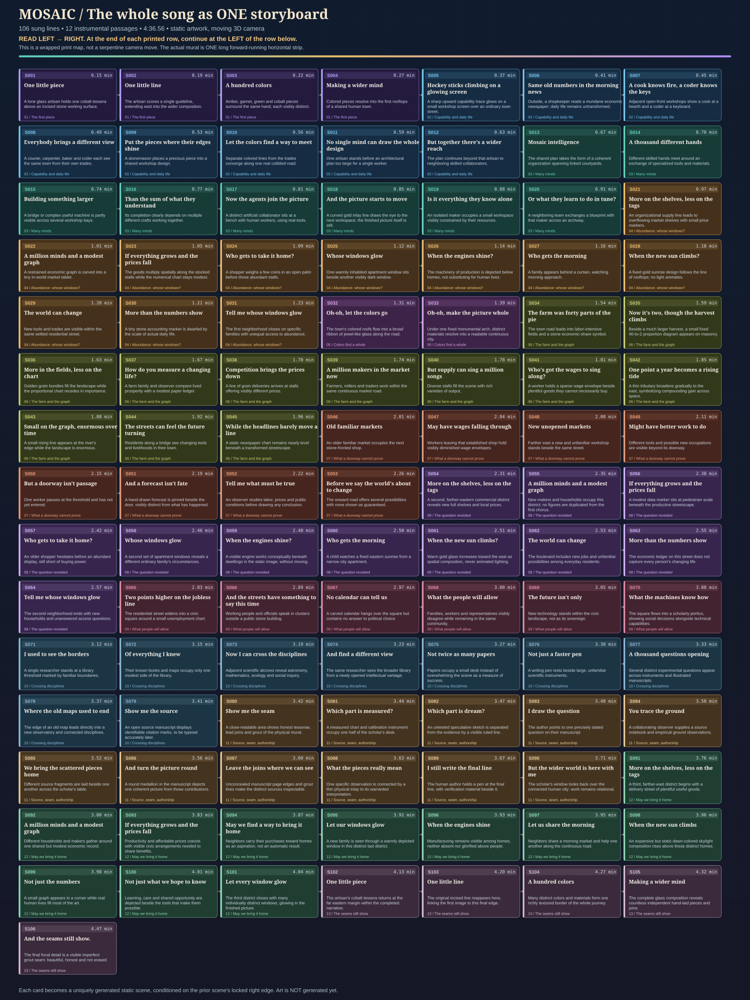

# MOSAIC — SEE THE MAP FIRST, THEN GENERATE EACH LINE

**[Open the full-size storyboard map](STORYBOARD_MAP.svg)**

This image contains **all 106 sung lines** arranged as a readable *folded paper storyboard* (seven cards per printed row). The actual film artwork is not folded: it remains **one extremely wide, flat, fixed mosaic**, experienced strictly **left → right** by a real moving 3D camera. Each box shows a **lyric time**, the **actual lyric**, and **the specific visible still scene** at that point. The map is schematic composition data, **not a generated art asset**.

The 12 instrumental intervals are listed in [FULL_SONG_STORYBOARD.md](FULL_SONG_STORYBOARD.md), and recorded with the 106 frames in [FULL_SONG_STORYBOARD.json](FULL_SONG_STORYBOARD.json).

## The revised process (the creator's preferred workflow)

**Stage 0 — Review/edit this entire map.** We approve the entire visual storyline, not 13 generic themes, and not 3 isolated polished images. This is the place to change an individual lyric's representation, reorder geography, make an emotional beat clearer, or introduce a cathedral/stained-glass motif at particular lyrics.

**Stage 1 — Prove the image seam with three consecutive lyric images.** Pick a fixed global image style and compose the first scene. Generate each next image *using the real right edge of the accumulated approved mural as locked pixel input on its left*, extending only the uncovered RIGHT side. Repeat for third. Inspect each join at full pixel scale and each lyric's depiction. This is NOT an alpha blend, crossfade, or transition; it is **rightward outpainting** of one finished, static work of art.

**Stage 2 — 106 sequential generations, one per lyric, WITHOUT lookahead.** The director/orchestrator reviews the full map, but the image model receives **only** (a) a short, invariant material/style instruction; (b) an image/mask containing the literal locked RIGHT EDGE of the cumulative, already-approved mural; and (c) the CURRENT lyric and its specific proposed new visual. Do **not** supply the full storyboard, the previous line's lyrics, or ANY future lyric/scene hints to inference. Extend into the new masked RIGHT area, never redraw accepted pixels. Save the image, prompt, model, masked-region/overlap hashes, metadata and approval/redo history. Do not charge/run 106 paid requests automatically.

**Stage 3 — Composite and inspect the immutable panorama.** The previously locked overlap is identical and included once; only the new unique rightward pixels extend the picture. Reject altered overlaps, disjoint perspective, abrupt character drift, blank gaps, repeated character/city clones, unverified numbers/text, and scenes where the wrong lyric is visible. The 13 chapter boundaries may help organize/stitch files, but are **not** generation units. The provisional 39m/39,936px wall is NOT final until tested for actual per-line readability.

**Stage 4 — Validate the full-song side-scroll against sound.** Camera X is monotonically increasing across the picture. Sung timestamps come from Suno's 655-word alignment, best-effort until verified by ear. We must see the content associated with a line *as the line is sung*. In a basic 2D proof only the framing/camera crop changes; no artwork moves. Review before any cathedral assets.

**Stage 5 — Place exactly that finished static art inside a static photorealistic 3D cathedral**, optionally with fixed stained-glass windows and real architecture. The **camera alone** moves; it never needs to jump backwards to depict a repeated lyric.

## The key seam contract

For lyric `S047`, the image generation receives **only the real, accepted cumulative mural's rightmost crop through `S046`, its locked mask, and the current lyric's visual target**. The full map is visible to the director only, never supplied to the image model. The previous crop is used as the **unchanged left context** on its input canvas; `S047` is painted only to the right. A consistency check verifies the locked crop before accepting the new continuation. In other words:

`[accepted prior image … | LOCKED overlap] + [NEW next lyric imagery →] = ONE extending still mural`.

A mere instruction to "match the last image" is NOT sufficient; it may produce a vaguely similar but disconnected image. Pixel-locked outpainting or explicit compositing of the preserved overlap is required.

**Why this matters:** Giving the model "what comes next" can make the next lyric appear *early*, contaminate this line's imagery, and impose premature compositional commitments. Previous **pixels**, not previous **lyric text**, carry continuity. We still need to watch for cumulative visual drift and test whether a constrained overlap actually performs better than a larger conditioning history; avoiding lookahead reduces one confound but does not guarantee perfect continuity.

**This process is provider-neutral.** Your own GPT Plan, an image-generation editor with controlled masks, or a local outpainting tool can provide assets. If a provider cannot preserve and extend the edge, use it only for rough concept drafts, not final seam-preserving output.

## What currently exists

- [Full visual storyboard map](STORYBOARD_MAP.svg) — reviewable schematic (real deliverable).
- [Line-generation plan for every lyric](LINE_GENERATION_PLAN.json) — **106 individual prompt/jobs** with exact lyric, preceding shot, next shot and overlap directives.
- [Every sung line's text storyboard](FULL_SONG_STORYBOARD.md) — detailed description and timestamps.
- An existing 13-chapter stitcher, 2D preview scaffold and Blender 4.x static cathedral blockout **from the prior 13-plate stage**; they are NOT yet updated to consume 106 generated images. Do not claim a working 106-shot production render until that ingest and real assets are verified.

No final 106 image generations have run. No extra Suno download or image-generation credit has been spent here.
